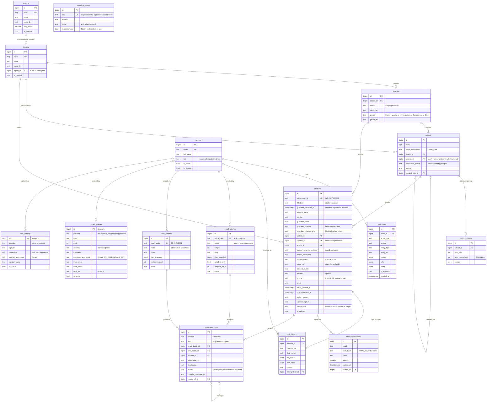

# Database

PostgreSQL 13+ (16 recommended) with the `pg_trgm` extension. The complete DDL (tables, constraints, indexes,
trigger functions) is in [`schema.sql`](schema.sql), generated with
`pg_dump --schema-only` from the migrated database. Migrations remain the source of truth.

## Entity-relationship diagram

`id_sequences (scope, year, last_value)` backs WikiScholar IDs and batch codes (the student ID
year is `WS_ID_YEAR`, default 2027). Django's own tables (`django_session`,
`django_content_type`, `auth_permission`, …) are omitted, as is `ws_cache`, the database cache
table created by `manage.py createcachetable` when `DJANGO_CACHE=db` (rate limits on hosts without
Redis; its rows are disposable).

## Tables by module

| Module | Table | Notes |
|---|---|---|
| Core | `admins` | Dashboard accounts. Deactivation = soft delete + `is_active=false`. |
| | `audit_logs` | Every sensitive action, including record views and exports. Append-only. |
| | `id_sequences` | Per-scope, per-year counters, allocated atomically with `ON CONFLICT DO UPDATE … RETURNING`. |
| Reference | `regions` | Editable in the dashboard. |
| | `districts` | `region_id` nullable and editable — the mapping is data. |
| | `upazilas` | Unique `(district_id, name)`; also unique `(id, district_id)` to support the composite FK. |
| | `schools` | Canonical list + pending registrant entries; merged rows are kept and point to `merged_into_id`. |
| | `school_aliases` | Alternate spellings; unique per school on the normalised text. |
| Registration | `students` | Region is not stored — derived via `district.region_id`. No date of birth (column dropped in migration `registration.0006`, October 2026). `section` is optional; `heard_from` is the "How did you hear about WikiScholar?" answer (empty for older rows). |
| | `email_verifications` | OTP attempts; UUID PK so IDs are unguessable. |
| | `edit_history` | One row per changed field; rows from one save share `change_set`. Append-only. |
| Notification | `email_batches`, `sms_batches` | One per bulk send, with an admin-chosen `name` (indexed, for search and the Students "Message history" filter); the filter used is stored as JSON. |
| | `notification_logs` | One row per recipient per attempt (also OTP and confirmation emails, and the confirmation SMS). `status` queued → sent → delivered, or failed / bounced ("not delivered"); `provider_message_id` is what delivery webhooks match (our Message-ID for SMTP, Brevo's `messageId` for the Brevo API). Queued rows are claimed with `SELECT … FOR UPDATE SKIP LOCKED`, so parallel senders never send one twice. |
| | `email_templates` | Super Admin wording of system emails, one row per registered key. "Reset to default" sets `is_customized=false` (no delete); changes are audited with before/after text. |
| | `email_settings`, `sms_settings` | One row each (pk 1): provider credentials entered by a Super Admin. Secrets are Fernet-encrypted and never audited; `is_active` decides whether they override the env settings. |

## Integrity enforced by the database

These hold even if application code has a bug or someone uses `psql` directly.

**No hard deletes.** A `BEFORE DELETE` trigger calling `ws_forbid_delete()` rejects deletes on
`students`, `schools`, `school_aliases`, `regions`, `districts`, `upazilas`, `admins`,
`email_verifications`, `email_batches`, `sms_batches` and `notification_logs`. Records are
archived with `is_deleted / deleted_at / deleted_by`. In Django, `.delete()` on these models
raises; `soft_delete()` and `restore()` are used instead, and the default manager hides
archived rows (`all_objects` shows them).

**Append-only history.** `ws_append_only()` rejects `UPDATE` and `DELETE` on `audit_logs` and
`edit_history`.

**Checks and keys.**
* `student_phone_bd_format` — `phone ~ '^01[3-9][0-9]{8}$'` (stored normalised, 11 digits).
* `student_roll_or_sid` / `student_roll_or_sid_not_blank` — class roll or SID must be non-blank.
* `student_class_6_to_10` — `current_class IN ('6'..'10')`.
* `student_heard_from_valid` — the survey answer `heard_from` is one of its choices, or empty for
  students who registered before the question existed.
* `student_guardian_declaration` — `filled_by = 'guardian'` exactly when `guardian_declared_at` is set.
* `student_relation_other_text` — `guardian_relation_other` is non-blank exactly when
  `guardian_relation = 'other'`.
  Both were added `NOT VALID`: enforced for every new or updated row, while rows registered before
  the rule are kept unchanged (fix them from the dashboard; `manage.py find_non_english` lists
  non-English text).
* `students_upazila_in_district` — composite FK `(upazila_id, district_id) → upazilas(id, district_id)`,
  so a student's upazila must belong to their district. Declared `DEFERRABLE INITIALLY
  DEFERRED`; checked at commit.
* `school_merged_has_target` — `merged` status ⇔ `merged_into_id` set.
* `notif_single_batch`, `notif_batch_matches_channel` — a log belongs to at most one batch, of
  its own channel.
* `upazila_district_name_uniq` — an area name is unique within its district; city-corporation
  thanas, cantonments and "Other area" are `upazilas` rows too (told apart by `group`), so they share
  this rule and the composite key above.
* Unique: `students.wikischolar_id`, `admins.email`, `regions.code`, `districts.code`,
  batch codes, `(scope, year)` in `id_sequences`.
* Foreign keys to students, schools and places use `ON DELETE PROTECT` semantics.

## Indexes that matter

* `school_name_trgm`, `alias_text_trgm` — GIN `gin_trgm_ops` for typeahead and duplicate
  detection.
* `school_upz_status_idx (upazila_id, verification_status)` — typeahead scope.
* `student_location_idx (district_id, upazila_id)`, `student_school_idx`, `student_gender_idx`,
  plus single-column indexes on `current_class`, `created_at`, `email`, `phone`,
  `is_deleted` — the dashboard filters.
* `audit_entity_idx (entity_type, entity_id)`, `audit_logs.created_at`, `action`.
* `notification_logs (status)`, `(provider_message_id)` — delivery reports and webhooks.

## Reference data

`data/reference_seed.json`: 6 regions, 64 districts (each with a region **code** only as its
initial assignment), 494 upazilas with Bangla names. Upazila data is derived from
[nuhil/bangladesh-geocode](https://github.com/nuhil/bangladesh-geocode) (MIT). Review the
upazila list against the current official BBS list before launch; add or rename any
missing ones from **Dashboard → Locations → district**.

## Backups & retention (recommended)

Daily `pg_dump` (or managed PITR), kept encrypted off-site, with a quarterly restore test.
Decide a retention period for `email_verifications` and OTP `notification_logs` (they can be
archived after, say, 90 days) as part of the data-protection policy.
